# StockSense — Documento técnico

**Predictor inteligente de agotamiento de inventario**
Proyecto académico · ExpoUNINPAHU 2026 (25–28 de noviembre de 2026)

> **Aviso:** todos los datos del proyecto (dataset de entrenamiento y registros iniciales de la aplicación) son **sintéticos**, generados con Python y semillas aleatorias reproducibles. Las métricas de este documento provienen de la ejecución real del notebook `notebooks/StockSense_Model_Training.ipynb` y representan un **experimento académico**, no un modelo validado con ventas reales.

---

## Contenido

1. [Descripción general](#1-descripción-general)
2. [Stack tecnológico y justificación](#2-stack-tecnológico-y-justificación)
3. [Modelado arquitectónico C4](#3-modelado-arquitectónico-c4)
4. [Diagramas UML](#4-diagramas-uml)
5. [Modelo de datos (SQLite)](#5-modelo-de-datos-sqlite)
6. [Modelo de inteligencia artificial](#6-modelo-de-inteligencia-artificial)
7. [Predicción de agotamiento, riesgo y reposición](#7-predicción-de-agotamiento-riesgo-y-reposición)
8. [Simulador de escenarios](#8-simulador-de-escenarios)
9. [Alertas](#9-alertas)
10. [Pruebas y validación técnica](#10-pruebas-y-validación-técnica)
11. [Limitaciones y trabajo futuro](#11-limitaciones-y-trabajo-futuro)
12. [Despliegue en Kubernetes y autorrecuperación](#12-despliegue-en-kubernetes-y-autorrecuperación)

---

## 1. Descripción general

StockSense es una aplicación web local para gestionar un inventario (productos, proveedores, ventas, movimientos y órdenes de compra). Además, con un modelo de **regresión lineal** entrenado con Scikit-learn:

* predice la demanda diaria de cada producto;
* estima cuántos días faltan para agotar las existencias y en qué fecha;
* clasifica el riesgo de quedarse sin inventario según el tiempo de entrega del proveedor;
* recomienda cuántas unidades reponer;
* genera alertas;
* compara escenarios comerciales (promoción, alta y baja demanda, retraso del proveedor).

El modelo se entrena **una sola vez**, fuera de la aplicación, en un notebook de Jupyter, y se exporta con Joblib. La aplicación Flask **solo carga** ese archivo y ejecuta `predict()` en cada solicitud.

---

## 2. Stack tecnológico y justificación

| Tecnología | Responsabilidad en StockSense | Justificación |
|---|---|---|
| **Python 3.12** | Lenguaje de todo el backend, del entrenamiento y de las pruebas | Un solo lenguaje para la web y la ciencia de datos; tiene el ecosistema de ML más maduro |
| **Flask 3.1** | Servidor web: rutas (blueprints), plantillas Jinja2, API JSON, comandos CLI (`flask init-db`) | Microframework sencillo y explícito, adecuado para un proyecto que se debe entender y sustentar |
| **SQLite** | Base de datos relacional en un archivo local (`stocksense.db`) | No requiere instalar un servidor; es transaccional, soporta llaves foráneas y restricciones `CHECK` |
| **Flask-SQLAlchemy 3.1** (SQLAlchemy 2.1) | ORM: modelos, relaciones, cascadas y consultas agregadas | Evita SQL manual repetitivo y protege contra inyección SQL; las transacciones mantienen el stock sincronizado |
| **Scikit-learn 1.9** | `Pipeline` con `FunctionTransformer`, `ColumnTransformer`, `StandardScaler`, `OneHotEncoder` y `LinearRegression`; métricas MAE, RMSE y R² | Biblioteca estándar de ML clásico; el `Pipeline` garantiza que el preprocesamiento sea idéntico al entrenar y al predecir |
| **Pandas 3.1** | Generación y manipulación del dataset, promedios móviles, separación temporal, filas de entrada al modelo | Manejo de datos tabulares y series de tiempo |
| **NumPy 2.5** | Simulación aleatoria reproducible (`default_rng`) y cálculos vectoriales (demanda acumulada) | Base numérica de Pandas y Scikit-learn |
| **Joblib 1.6** | Serializa el Pipeline entrenado (`models/demand_model.joblib`) y lo carga en Flask | Formato recomendado por Scikit-learn para modelos con arreglos NumPy |
| **Jupyter Notebook** | Entrenamiento documentado: EDA, limpieza, selección de variables, evaluación y exportación | Combina código, resultados y explicación en un entregable reproducible |
| **Matplotlib / Seaborn** | Gráficas del notebook (correlaciones, distribuciones, residuos) | Visualización estadística estándar |
| **HTML5 + Jinja2** | Estructura de las páginas, renderizadas en el servidor | Las vistas reciben datos ya calculados por Flask |
| **CSS3 + Bootstrap 5.3** | Diseño responsive (barra lateral, tarjetas, tablas y formularios) y paleta propia en `static/css/styles.css` | Interfaz profesional sin escribir un framework CSS desde cero |
| **JavaScript** | Llamadas `fetch()` a la API JSON de predicciones y escenarios, búsqueda en tablas y ayudas de formularios | Permite ejecutar predicciones sin recargar la página |
| **Chart.js 4.4** | Gráficos interactivos: ventas, inventario, riesgo, demanda estimada y escenarios | Ligero y fácil de configurar |
| **pytest 9** | Pruebas automatizadas unitarias y de integración | Estándar de facto en Python |
| **Docker** (imagen `python:3.12.8-slim`) | Empaqueta la app, sus dependencias y el modelo entrenado en una imagen (`Dockerfile`) | La misma imagen corre igual en cualquier equipo; es el requisito para Kubernetes |
| **Gunicorn 23** | Servidor WSGI de producción dentro del contenedor (proceso principal, PID 1) | El servidor de desarrollo de Flask no es apto para producción |
| **Kubernetes** (minikube local, kubectl, Kustomize) | Orquesta 2 réplicas: sondas de salud, reinicio automático, balanceo, volumen persistente y actualizaciones sin caída (`k8s/`) | Cumple el requisito de **tolerancia a caídas y autorrecuperación** sin servicios pagos: minikube corre en el propio equipo |

**Ejecución sin internet.** Bootstrap, Bootstrap Icons y Chart.js se sirven desde `static/vendor/` y no desde un CDN. Así la demostración en la Expo funciona sin conexión. El proyecto no usa APIs externas ni servicios en la nube.

**Dos formas de ejecución.** (1) Local en Windows con `python app.py`, para desarrollo. (2) En un clúster **Kubernetes local (minikube)**, para la demostración de tolerancia a fallas (sección 12). El código es el mismo; solo cambian variables de entorno (`STOCKSENSE_DB_PATH`, `STOCKSENSE_SEED_ON_STARTUP`, `STOCKSENSE_ENABLE_CHAOS`). Construir la imagen requiere internet una vez (descarga de Python y paquetes); después el clúster funciona sin conexión.

### Cómo se comunican

```
Navegador ──HTTP──▶ Flask (blueprints) ──▶ services/* ──▶ Flask-SQLAlchemy ──▶ SQLite
    ▲                       │                    │
    │  HTML (Jinja2) o JSON │                    └──▶ PredictionService ──▶ Pipeline .joblib (predict)
    └───────────────────────┘
Jupyter (offline) ──▶ data/synthetic_sales.csv ──▶ entrenamiento ──▶ models/demand_model.joblib + model_metadata.json
```

1. El navegador solicita una página. Flask consulta SQLite mediante los servicios y responde HTML renderizado con Jinja2.
2. En Predicciones y Simulador, JavaScript envía un `POST` con JSON. Flask valida los datos, el `PredictionService` lee el historial de ventas desde SQLite, construye las variables y ejecuta `predict()` con el Pipeline cargado. El resultado vuelve como JSON y Chart.js lo dibuja.
3. El notebook es independiente de Flask. Su única conexión con la aplicación son los archivos exportados en `models/` y los módulos compartidos `ml/features.py` y `ml/forecasting.py`, que garantizan que las variables se calculen igual en el entrenamiento y en la inferencia.

### Estructura del código

| Carpeta | Contenido |
|---|---|
| `app.py`, `config.py` | Fábrica de la aplicación (`create_app`), carga del modelo, filtros de plantillas, manejo de errores y comando `init-db` |
| `database/` | `models.py` (6 tablas), `seed.py` (datos iniciales) |
| `services/` | `inventory_service`, `prediction_service`, `scenario_service`, `alert_service`, `validators` |
| `routes/` | Blueprints: `dashboard`, `products`, `sales`, `suppliers`, `predictions`, `scenarios`, `alerts`, `health` (sondas de Kubernetes) |
| `ml/` | `simulation.py` (reglas comerciales), `generate_dataset.py`, `features.py`, `forecasting.py` |
| `notebooks/` | `StockSense_Model_Training.ipynb` |
| `models/` | `demand_model.joblib`, `model_metadata.json` |
| `templates/`, `static/` | Interfaz web |
| `tests/` | Pruebas pytest |
| `docs/` | Este documento, diagramas PlantUML, imágenes y resultados de pruebas |
| `Dockerfile`, `.dockerignore`, `requirements-docker.txt` | Imagen de contenedor de la aplicación |
| `k8s/` | Manifiestos de Kubernetes (Namespace, PV/PVC, Deployment, Service, PodDisruptionBudget, Kustomization) y scripts `.bat` de despliegue y demo |

**Ajustes justificados a la estructura propuesta:**
* Se agregó la carpeta `ml/` para que el notebook y Flask compartan el mismo código de simulación, variables y pronóstico (evita duplicación y diferencias entre entrenamiento e inferencia).
* Se agregaron `services/scenario_service.py`, `services/validators.py`, `routes/alerts.py` y `tests/test_scenarios_alerts.py` para separar responsabilidades.
* En lugar de Flask-WTF se implementó un validador propio (`FormValidator`), opción permitida por el enunciado. Es sencillo de explicar y sirve por igual para formularios HTML y para la API JSON.

---

## 3. Modelado arquitectónico C4

Las fuentes de los diagramas están en `docs/diagrams/` (PlantUML con la biblioteca estándar C4-PlantUML) y las imágenes generadas en `docs/images/`.

### 3.1 Nivel 1 — Contexto (`c4_context.puml`)

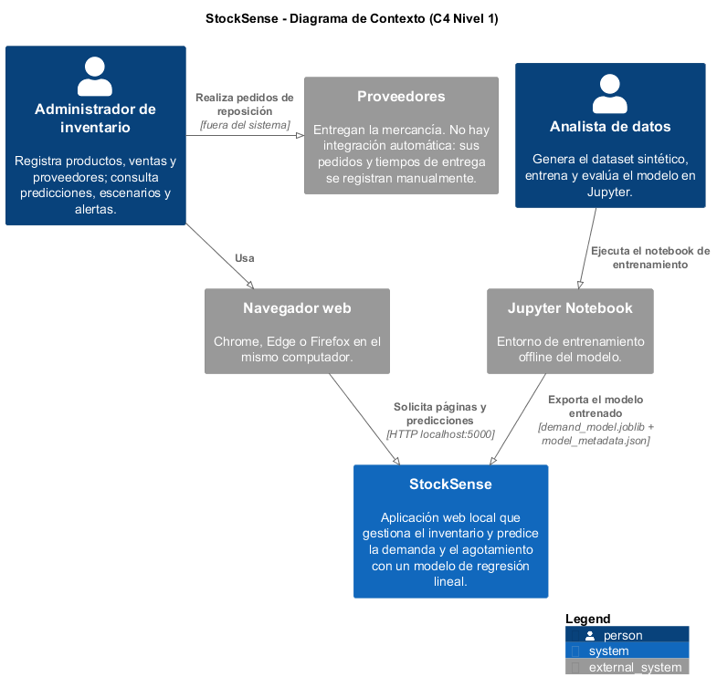

Muestra el sistema StockSense como una caja negra con sus actores:

* **Administrador de inventario:** usa la aplicación desde el navegador para registrar productos y ventas y consultar predicciones, escenarios y alertas.
* **Analista de datos:** ejecuta el notebook en Jupyter para generar el dataset y entrenar el modelo.
* **Jupyter Notebook:** sistema externo de entrenamiento. Entrega a StockSense el archivo del modelo; no hay comunicación en tiempo de ejecución.
* **Proveedores:** entregan la mercancía. No están integrados (no hay API): sus tiempos de entrega y pedidos se registran manualmente.

**Decisión clave:** el entrenamiento está fuera del sistema en ejecución. La aplicación no depende de Jupyter para funcionar, solo del archivo exportado.

### 3.2 Nivel 2 — Contenedores (`c4_containers.puml`)

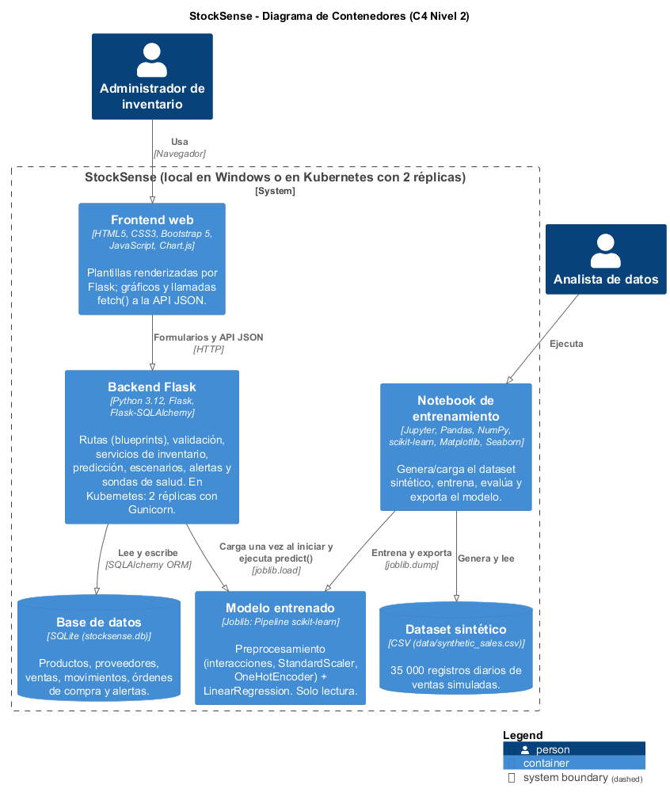

| Contenedor | Tecnología | Responsabilidad |
|---|---|---|
| Frontend web | HTML, Bootstrap, JavaScript, Chart.js | Presentación, formularios, gráficos y llamadas a la API JSON |
| Backend Flask | Python, Flask, SQLAlchemy | Lógica de negocio, validación, inferencia y alertas |
| Base de datos | SQLite (`stocksense.db`) | Persistencia transaccional |
| Modelo entrenado | Pipeline Scikit-learn (Joblib) | Preprocesamiento + regresión; solo lectura |
| Notebook | Jupyter + Pandas + Scikit-learn | Entrenamiento y evaluación offline |
| Dataset | CSV | Datos sintéticos de entrenamiento |

Es una **arquitectura monolítica en capas**, sin microservicios: el alcance del proyecto no los necesita y así es más fácil de ejecutar y sustentar. El modelo se carga **una sola vez** al iniciar Flask (`create_app`) y se guarda en `app.extensions["prediction_service"]`.

En Kubernetes, el contenedor *Backend Flask* se ejecuta como **2 réplicas idénticas** del mismo monolito (no son microservicios: cada réplica tiene todo el sistema). Ambas comparten la misma base SQLite en un volumen persistente. La vista de despliegue está en `deployment_k8s.puml` (sección 12).

### 3.3 Nivel 3 — Componentes del backend (`c4_components.puml`)

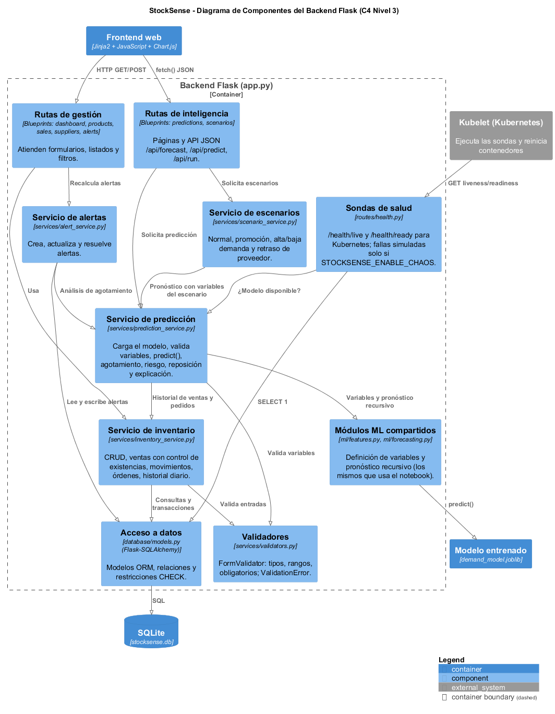

* **Rutas de gestión** (`dashboard`, `products`, `sales`, `suppliers`, `alerts`): reciben formularios, llaman a los servicios y renderizan plantillas. No contienen lógica de negocio.
* **Rutas de inteligencia** (`predictions`, `scenarios`): exponen la API JSON (`/predictions/api/forecast`, `/predictions/api/predict`, `/scenarios/api/run`) y devuelven errores uniformes (400 validación, 404 inexistente, 503 sin modelo).
* **Validadores** (`FormValidator`): conversión de tipos, campos obligatorios, rangos, formatos y acumulación de errores por campo.
* **Servicio de inventario:** CRUD, registro de ventas con control de existencias, movimientos, órdenes de compra y consultas de historial diario.
* **Servicio de predicción:** carga y valida el modelo, prepara variables, ejecuta `predict()`, recorta negativos, calcula agotamiento, riesgo y reposición, y explica la predicción.
* **Servicio de escenarios:** construye los cinco escenarios sobre el servicio de predicción.
* **Servicio de alertas:** evalúa condiciones y crea, actualiza o resuelve alertas.
* **Módulos ML compartidos:** `ml/features.py` (variables) y `ml/forecasting.py` (pronóstico recursivo), usados también por el notebook.
* **Acceso a datos:** modelos ORM de Flask-SQLAlchemy con relaciones y restricciones.
* **Sondas de salud** (`routes/health.py`): `/health/live` (¿el proceso responde?) y `/health/ready` (¿la base de datos y el modelo están disponibles?), consultadas por Kubernetes.

---

## 4. Diagramas UML

### 4.1 Diagrama de secuencia — inferencia (`sequence_inference.puml`)

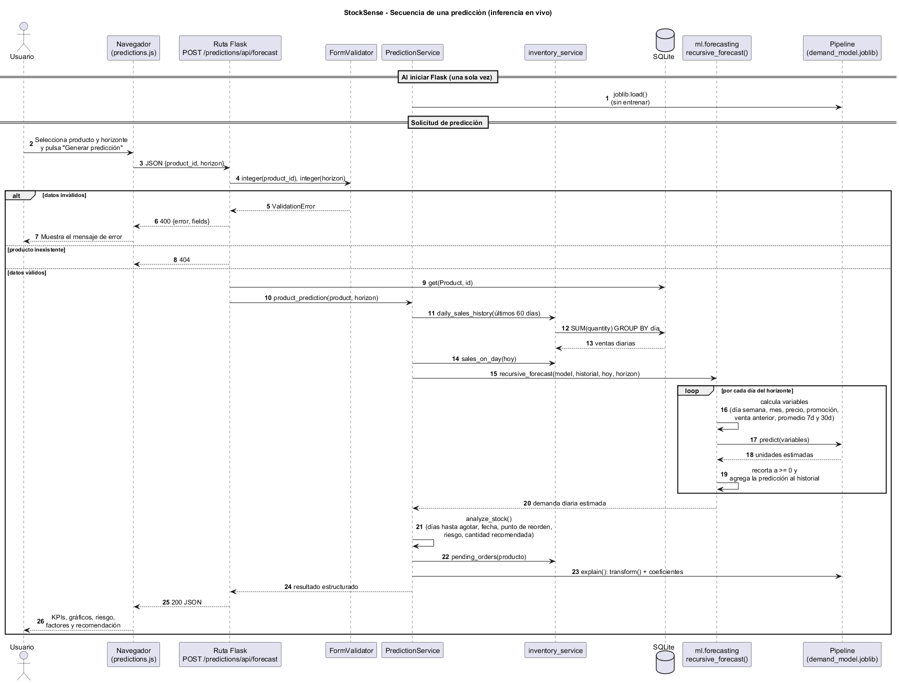

Representa desde que el usuario pide una predicción hasta que recibe el resultado:

1. **Al iniciar Flask**, `PredictionService` ejecuta `joblib.load()` una sola vez (sin entrenar).
2. El usuario elige un producto y un horizonte; `predictions.js` envía `POST /predictions/api/forecast`.
3. La ruta valida `product_id` y `horizon` con `FormValidator`:
   * datos inválidos → **400** con el detalle por campo;
   * producto inexistente → **404**.
4. `PredictionService.product_prediction()` pide al servicio de inventario las ventas diarias de los últimos 60 días (SQL `SUM ... GROUP BY día`) y lo ya vendido hoy.
5. `recursive_forecast()` repite para cada día del horizonte: construir variables (día de la semana, mes, precio, promoción, venta anterior, promedios 7 y 30 días) → `model.predict()` → recortar a ≥ 0 → agregar la predicción al historial para el día siguiente.
6. `analyze_stock()` calcula los días hasta el agotamiento, la fecha, el punto de reorden, el riesgo y la cantidad recomendada; `explain()` descompone la predicción con los coeficientes.
7. La respuesta JSON se muestra en indicadores, gráficos, la tabla de factores y la recomendación.

### 4.2 Diagrama de actividades — funcionamiento del sistema (`activity_system.puml`)

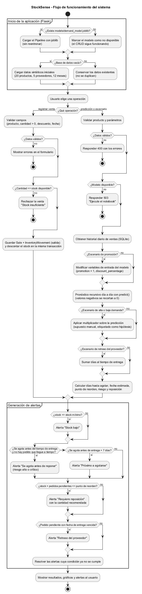

Representa el flujo completo con sus decisiones:

* **Inicio:** si el archivo del modelo existe, se carga; si no, la aplicación sigue funcionando sin predicciones. Si la base de datos está vacía, se cargan los datos iniciales; si no, se conservan (no se duplican).
* **Registrar venta:** validación de campos → verificación de `cantidad ≤ stock` → registro atómico de `Sale` + `InventoryMovement` y descuento del stock.
* **Predicción o escenario:** validación → verificación de disponibilidad del modelo (503 si falta) → historial → modificación de variables si hay promoción → pronóstico recursivo → multiplicador si es un escenario de supuesto → ajuste del tiempo de entrega si hay retraso → cálculo de agotamiento, riesgo y reposición.
* **Alertas:** stock bajo, agotamiento antes de reponer, agotamiento próximo, reposición requerida y retraso del proveedor; las alertas cuya condición desaparece se resuelven.

---

## 5. Modelo de datos (SQLite)

| Tabla | Campos | Restricciones y relaciones |
|---|---|---|
| `suppliers` | id, name, contact, email, phone, delivery_days | `name` único; `delivery_days > 0` |
| `products` | id, name, category, description, price, current_stock, minimum_stock, supplier_id, created_at | `name` único; `price > 0`; `current_stock ≥ 0`; `minimum_stock ≥ 0`; FK a `suppliers` (RESTRICT) |
| `sales` | id, product_id, sale_date, quantity, unit_price, promotion, discount_percentage | `quantity > 0`; `unit_price ≥ 0`; descuento 0–100; FK a `products` (CASCADE) |
| `inventory_movements` | id, product_id, movement_type, quantity, movement_date, description | tipo ∈ {entrada, salida, ajuste}; `quantity ≠ 0`; entrada > 0 y salida < 0 |
| `purchase_orders` | id, supplier_id, product_id, quantity, order_date, expected_delivery, status | `quantity > 0`; estado ∈ {pendiente, recibida, cancelada}; `expected_delivery ≥ order_date` |
| `alerts` | id, product_id, alert_type, message, created_at, status | tipo ∈ {stock_bajo, agotamiento_proximo, quiebre_antes_reposicion, reposicion, retraso_proveedor}; estado ∈ {activa, resuelta} |

**Reglas de consistencia:**
* Las llaves foráneas se activan en SQLite con `PRAGMA foreign_keys=ON` en cada conexión (`database/__init__.py`).
* **El stock solo cambia junto con un movimiento**, en la misma transacción (`inventory_service._add_movement`). Una venta crea una salida; editar el stock crea un ajuste; recibir una orden crea una entrada. Por eso **`current_stock = Σ movimientos`**, invariante que verifican las pruebas.
* No se registran ventas mayores al stock disponible (validación en el servicio + restricción `current_stock ≥ 0`).
* Las estadísticas del dashboard (totales, demanda estimada, mayor rotación, ventas diarias) **se calculan** con consultas; no se guardan como registros. Tampoco se guarda el "retraso" de un pedido: se deriva de `status = pendiente` y `expected_delivery < hoy`.
* Al eliminar un producto se eliminan en cascada sus ventas, movimientos, órdenes y alertas (con confirmación en la interfaz). No se puede eliminar un proveedor con productos u órdenes.

**Datos iniciales (`database/seed.py`):** 5 proveedores (entregas de 2, 3, 5, 7 y 10 días), 20 productos de seis categorías y tres niveles de rotación, y 365 días de historia que terminan el día anterior a la carga. El seed genera unas 7 200 ventas, 7 500 movimientos y 340 órdenes recibidas, más 4 órdenes pendientes (2 de ellas retrasadas). Usa el **mismo simulador** que el dataset de entrenamiento. Los niveles finales de stock varían a propósito: algunos productos quedan por debajo del mínimo, otros próximos a agotarse y otros con más de 60 días de cobertura. Solo se ejecuta si la base está vacía.

---

## 6. Modelo de inteligencia artificial

### 6.1 Generación de datos sintéticos

`ml/generate_dataset.py` (semilla 42) simula **50 productos durante 730 días** (2024–2025). Tras descartar los primeros 30 días de cada producto (no tienen promedio de 30 días) quedan **35 000 registros**.

La demanda diaria de cada producto se construye con reglas comerciales (`ml/simulation.py`):

```
demanda_esperada = base_rotación × factor_día_semana × factor_mes × (1 + tendencia·t)
                   × (precio / precio_base)^(−elasticidad) × (1 + 2.5 · descuento/100)
demanda = Poisson(demanda_esperada × Gamma(12, 1/12))
```

| Regla | Valores |
|---|---|
| Rotación | alta 25–60, media 8–20, baja 1–5 unidades/día |
| Fin de semana | aumento de 5 % (Aseo) a 35 % (Bebidas) |
| Temporada | enero 0.88 … diciembre 1.10, más un aumento navideño por categoría |
| Tendencia | entre −10 % y +25 % anual por producto |
| Precio | cambios ocasionales de ±15 % con elasticidad entre 0.8 y 1.8 |
| Promociones | ~13 % de los días; descuentos de 10–40 % |
| Ruido | Gamma-Poisson (variación ~29 %) |
| Inventario | política de punto de reorden; 15 % de los pedidos llegan tarde y causan quiebres |

### 6.2 Ventas observadas vs. demanda

La venta registrada es `min(demanda, stock disponible)`. En los días con quiebre de stock (`stockout = 1`, el 0.83 % de los registros: 292) la venta observada **subestima** la demanda. Esos días se **excluyen del entrenamiento**, y `units_available` **no** se usa como predictor: está correlacionada con las ventas (r = 0.71) solo porque la política de reposición surte más a los productos que más venden. Usarla haría que el modelo aprendiera la política de inventario y no la demanda.

### 6.3 Variables

**Objetivo:** `units_sold` (unidades vendidas por día).

| Variable | Tratamiento en el Pipeline |
|---|---|
| `price`, `discount_percentage`, `promotion` | `StandardScaler` |
| `previous_sales`, `average_sales_7d`, `average_sales_30d` | `StandardScaler` (calculadas con `shift(1)` para evitar fuga) |
| `discount_x_avg30`, `weekend_x_avg30` | Derivadas en el Pipeline (`FunctionTransformer`) + `StandardScaler`; permiten efectos proporcionales al nivel de ventas |
| `day_of_week`, `month`, `category` | `OneHotEncoder(drop="first", handle_unknown="ignore")`: sus efectos no son lineales |

Excluidas: `units_available` (política de inventario), `stockout` (solo para limpiar), `rotation` (parámetro oculto del simulador), `product_id` (no generaliza a productos nuevos; ver 6.5).

### 6.4 Preprocesamiento y separación

* Verificación de nulos y duplicados (0 en ambos), validación de rangos y exclusión de las ventas censuradas → 34 708 registros.
* **Separación temporal** (no aleatoria) para evaluar fechas posteriores al entrenamiento:

| Conjunto | Periodo | Registros |
|---|---|---|
| Entrenamiento | 31-ene-2024 a 30-abr-2025 | 22 648 |
| Validación | 01-may-2025 a 31-ago-2025 | 6 063 |
| Prueba | 01-sep-2025 a 30-dic-2025 | 5 997 |

* Todo el preprocesamiento está dentro del `Pipeline` y se ajusta solo con los datos de entrenamiento, así no hay fuga hacia validación ni prueba.
* El modelo se elige con validación; luego se reentrena con entrenamiento + validación (28 711 registros) y se evalúa **una sola vez** en prueba.

### 6.5 Entrenamiento y selección (conjunto de validación)

| Modelo | MAE | RMSE | R² |
|---|---|---|---|
| Línea base: promedio de los últimos 7 días (sin modelo) | 7.450 | 14.440 | 0.731 |
| A: regresión con variables numéricas | 7.054 | 13.040 | 0.780 |
| B: A + OneHot de día, mes y categoría | 7.033 | 12.918 | 0.784 |
| **C: B + interacciones (seleccionado)** | **6.550** | **11.746** | **0.822** |
| D: C + OneHot de `product_id` | 6.304 | 11.572 | 0.827 |

Se eligió **C**. La mejora de D es pequeña (MAE −0.25) y D depende del identificador de cada producto, por lo que no podría predecir productos registrados después del entrenamiento, que es justamente una operación de la demostración. C usa características que cualquier producto tiene: su categoría y su nivel de ventas recientes.

### 6.6 Resultados en el conjunto de prueba

*(Valores reales de `models/model_metadata.json`, entrenamiento del 2026-11-08.)*

| Métrica | Valor | Interpretación |
|---|---|---|
| **MAE** | **6.63** unidades | Error absoluto medio por día; ≈ 30 % de la venta media diaria (21.8 u.) |
| **RMSE** | **11.84** unidades | Mayor que el MAE: hay errores grandes en productos de alta rotación y en promociones |
| **R²** | **0.819** | El modelo explica ≈ 82 % de la variabilidad de las ventas diarias |

Validación (6.55 / 11.75 / 0.822) y prueba (6.63 / 11.84 / 0.819) son casi iguales, así que no hay señales de sobreajuste.

**Por nivel de rotación (prueba):**

| Rotación | Venta media | MAE | MAE relativo | R² dentro del grupo |
|---|---|---|---|---|
| Alta | 58.1 | 15.69 | 27 % | 0.60 |
| Media | 16.3 | 5.12 | 32 % | 0.37 |
| Baja | 3.8 | 2.29 | 60 % | −0.12 |

El R² global es alto porque el modelo distingue bien productos de distinto nivel de ventas. **Dentro** de un mismo grupo el poder explicativo es menor. En los productos de baja rotación la variación diaria es casi pura aleatoriedad, y el modelo no supera al promedio del grupo. Esto se reporta tal cual; no se oculta.

**Sobreajuste, subajuste y posibles errores**

* **Sobreajuste:** no hay señales. Las métricas de validación (R² 0.822) y de prueba (R² 0.819) prácticamente coinciden, aunque el conjunto de prueba son meses posteriores a todo el entrenamiento. La regresión lineal tiene pocos parámetros respecto a las 28 711 filas de entrenamiento, y las pruebas automáticas con muestras nuevas (semillas 7, 123 y 999) dan R² entre 0.78 y 0.82.
* **Subajuste:** sí lo hay, de forma parcial. El modelo es lineal y la demanda real tiene efectos multiplicativos (la promoción aumenta más las ventas de los productos que ya venden mucho). Las interacciones `discount_x_avg30` y `weekend_x_avg30` lo corrigen solo en parte: subieron el R² de validación de 0.784 a 0.822. En baja rotación el modelo no capta la variación diaria (R² −0.12).
* **Posibles errores en uso:**
    1. Subestimar la demanda en promociones de productos de alta rotación (es donde el RMSE es mayor).
    2. Acumular error en horizontes largos, porque cada día pronosticado alimenta el siguiente.
    3. Predecir demanda baja si el historial reciente tiene días sin ventas registradas. La aplicación muestra un aviso cuando el historial lleva 2 o más días sin ventas.
    4. Predicciones poco confiables para productos nuevos, sin historial.

**Pronóstico recursivo a 30 días (uso real en la aplicación).** Se pronosticaron 30 días de cada uno de los 50 productos desde el 01-sep-2025 con `ml/forecasting.py`, el mismo código que usa Flask, y se compararon las unidades totales:

| Métrica | Valor |
|---|---|
| MAE del total de 30 días | 92.9 unidades |
| MAPE del total de 30 días | 14.3 % |
| R² entre productos | 0.836 |

Los errores diarios se compensan en parte al acumular varios días. Por eso la estimación de agotamiento, que usa demanda acumulada, es más confiable que la predicción de un día aislado.

Gráficas del notebook:

| | |
|---|---|
| 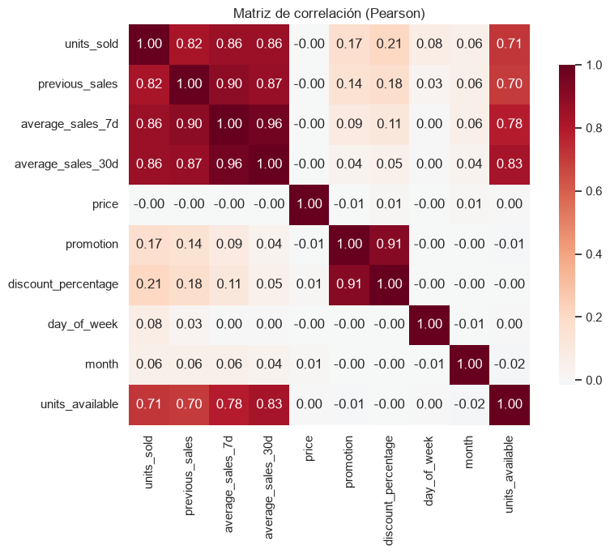 | 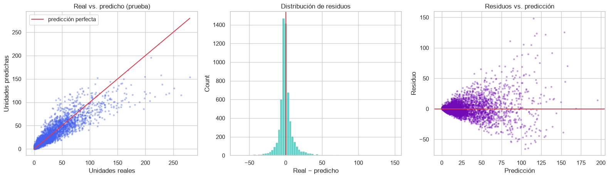 |
| 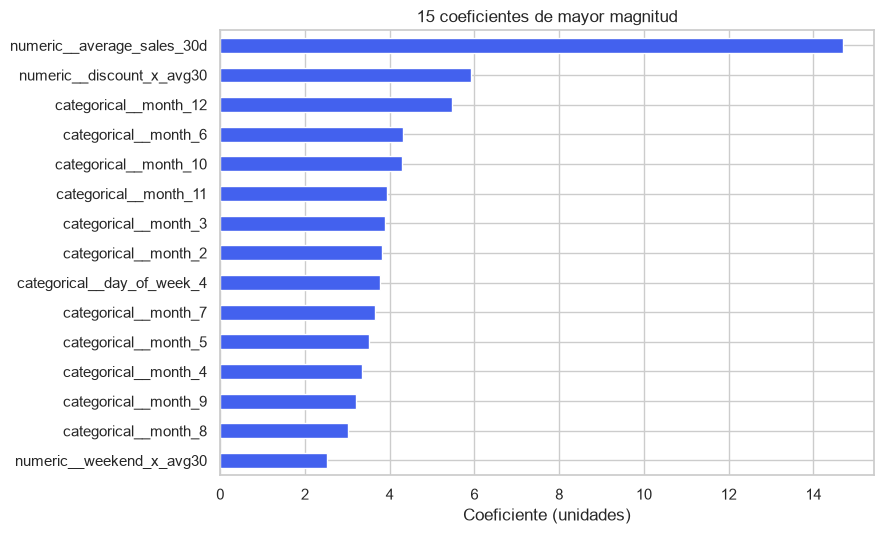 | 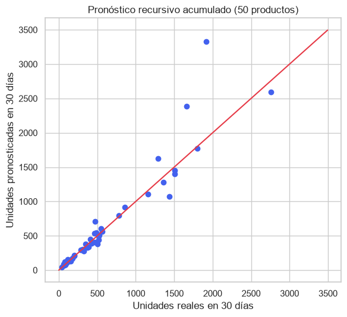 |

### 6.7 Exportación

* `models/demand_model.joblib`: Pipeline completo (`interactions` → `preprocess` → `regressor`).
* `models/model_metadata.json`: fecha de entrenamiento, versión (1.0.0), variables usadas y excluidas, métricas (validación, prueba, línea base, pronóstico recursivo), comparación de modelos, número de registros, descripción del dataset, separación y versiones de las librerías.

El notebook vuelve a cargar el archivo exportado y verifica que produce exactamente las mismas predicciones.

### 6.8 Explicabilidad

Como el modelo es lineal, cada predicción se descompone exactamente:

```
predicción = intercepto + Σ coeficiente_i × variable_transformada_i
```

`PredictionService.explain()` muestra la contribución en unidades de cada factor (variables numéricas frente al promedio del entrenamiento; categóricas frente a la referencia lunes / enero / Abarrotes). Una prueba automatizada verifica que la suma coincide con `predict()`.

---

## 7. Predicción de agotamiento, riesgo y reposición

**Pronóstico día a día (no se usa una demanda constante).** Para cada día del horizonte (30, 60 o 90 días) se usa su propio día de la semana y mes, el precio actual y las condiciones del escenario. La venta anterior y los promedios móviles incluyen las predicciones de los días previos (pronóstico recursivo). La demanda estimada de hoy se reduce con lo que ya se vendió hoy.

| Cálculo | Fórmula |
|---|---|
| Días hasta agotar | primer día *k* en que la demanda acumulada ≥ stock, con interpolación dentro del día: `k + (stock − acumulado_{k−1}) / demanda_k` |
| Fecha de agotamiento | hoy + *k* días |
| Punto de reorden | demanda estimada durante el tiempo de entrega + stock mínimo (stock de seguridad) |
| ¿Requiere reposición? | stock + pedidos pendientes ≤ punto de reorden |
| Cantidad recomendada | demanda estimada de (entrega + 14 días de cobertura) + stock mínimo − stock − pedidos pendientes (mínimo 0) |

| Riesgo | Condición |
|---|---|
| **Crítico** | sin existencias, o se agota en ≤ 2 días antes de que pueda llegar un pedido hecho hoy |
| **Alto** | se agota antes del tiempo de entrega del proveedor y no hay pedido pendiente que llegue a tiempo |
| **Medio** | se agota antes de entrega + 7 días, o hay un pedido que llega justo a tiempo, o el stock está por debajo del mínimo |
| **Bajo** | el stock cubre la demanda estimada más allá del tiempo de entrega |

Advertencias automáticas: historial menor a 7 o a 30 días, ninguna venta en los últimos 14 días, y descuentos fuera del rango de entrenamiento (10–40 %).

---

## 8. Simulador de escenarios

| Escenario | Qué cambia | Origen del resultado |
|---|---|---|
| Normal | Nada: precio actual, sin promoción | **Modelo** |
| Promoción | `promotion = 1` y `discount_percentage` durante N días (variables de entrada) | **Modelo**: el aumento de demanda es el que aprendió la regresión |
| Alta demanda | Predicción normal × (1 + x %) | **Modelo + supuesto**: hipótesis manual, no aprendida |
| Baja demanda | Predicción normal × (1 − y %) | **Modelo + supuesto**: hipótesis manual, no aprendida |
| Retraso del proveedor | Tiempo de entrega + d días | **Modelo** (la demanda no cambia; cambian el riesgo y la reposición) |

Cada tarjeta muestra sus supuestos, las unidades estimadas (7 y 30 días), los días y la fecha de agotamiento, el tiempo de entrega, el riesgo y la reposición sugerida. Una etiqueta indica si el resultado es del modelo o incluye un supuesto. Hay gráficos comparativos de la proyección del stock y de días hasta agotarse frente al tiempo de entrega. Los controles deslizantes recalculan con el modelo al moverlos.

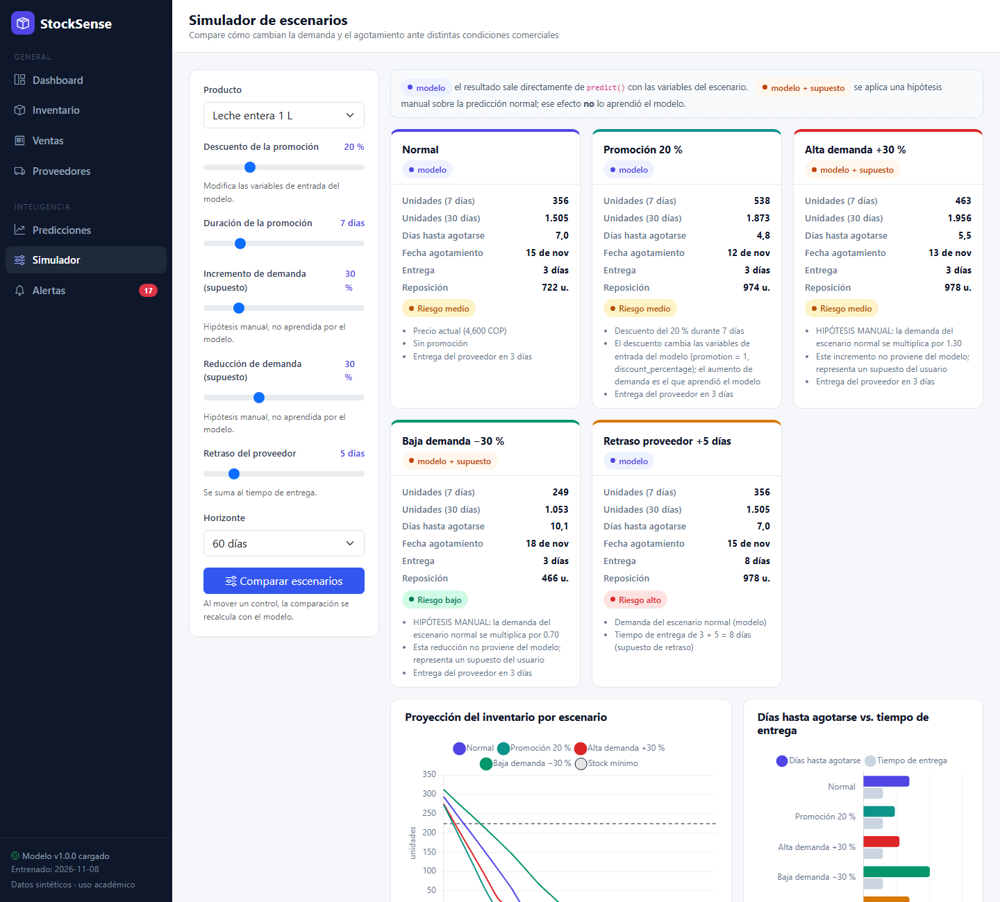

---

## 9. Alertas

`alert_service.refresh_alerts()` evalúa cada producto con el stock actual, los pedidos pendientes y una pasada del modelo (una llamada a `predict()` por día para todos los productos a la vez):

| Tipo | Condición |
|---|---|
| Stock bajo | `current_stock ≤ minimum_stock` |
| Se agota antes de reponer | agotamiento estimado < tiempo de entrega y ningún pedido llega a tiempo |
| Próximo a agotarse | agotamiento estimado < tiempo de entrega + 7 días |
| Requiere reposición | stock + pendientes ≤ punto de reorden (incluye la cantidad recomendada y un botón para crear la orden) |
| Retraso del proveedor | orden pendiente con fecha de entrega vencida |

Hay como máximo una alerta **activa** por producto y tipo. Si la condición persiste se actualiza el mensaje; si desaparece, la alerta pasa a *resuelta* y queda en el historial. Las alertas se recalculan después de cada venta, movimiento, edición u orden, y al abrir el dashboard o la página de alertas.

---

## 10. Pruebas y validación técnica

Se ejecutan con `python -m pytest`. Usan SQLite en memoria (no tocan `stocksense.db`) y el modelo real `models/demand_model.joblib`.

**Resultado (24-nov-2026): 79 pruebas, 79 aprobadas, 0 fallidas (≈ 35 s).** La salida completa está en [`docs/resultados_pruebas.txt`](resultados_pruebas.txt).

| Archivo | Pruebas | Qué verifica |
|---|---|---|
| `test_products.py` | 10 | Registro (fila + movimiento inicial), campos obligatorios, valores negativos, nombre duplicado y categoría inválida, edición con ajuste de stock, 404, eliminación en cascada, búsqueda y filtro por nivel, restricción al eliminar proveedores, asociación de productos |
| `test_sales.py` | 13 | La venta descuenta stock y crea la salida; rechazo de ventas mayores al stock; vender exactamente el stock; cantidades 0, negativas, decimales, texto y vacías; reglas de promoción y precio con descuento; fecha futura; filtros por producto y fecha; ajustes que dejarían stock negativo; recepción de órdenes |
| `test_validation.py` | 15 | `FormValidator`: obligatorios, enteros, rangos, negativos, NaN, longitud, opciones, correo, fechas; validación de proveedores; API con datos mal formados (400) |
| `test_predictions.py` | 23 | Existencia y carga del modelo (Pipeline + LinearRegression + metadatos); **Flask no entrena** (`fit()` bloqueado con *monkeypatch* y hash del `.joblib` sin cambios); modelo ausente → 503 sin afectar el CRUD; estructura de `predict()`; sensibilidad a historial y descuento; recorte de negativos; entradas inválidas; la explicación suma la predicción; cálculo exacto de agotamiento, riesgo y reposición; API de extremo a extremo; productos sin historial; una venta de hoy se refleja en la predicción; **datos no vistos**; aviso cuando el historial lleva días sin ventas |
| `test_health.py` | 6 | Sondas de Kubernetes: liveness y readiness correctas; readiness falla (503) sin modelo mientras liveness sigue viva; endpoints de falla deshabilitados por defecto (404); el cuelgue simulado hace fallar las sondas y las páginas; la caída simulada termina el proceso principal |
| `test_scenarios_alerts.py` | 12 | Los cinco escenarios y sus orígenes; la promoción aumenta la demanda vía modelo; multiplicadores exactos; el retraso solo cambia la entrega; alta demanda adelanta el agotamiento; alertas creadas, no duplicadas y resueltas; alerta de retraso de proveedor; todos los módulos renderizan con datos completos |

**Pruebas con datos no usados en el entrenamiento.** Se generan muestras nuevas con otras semillas (7 y 123), otros productos y fechas de 2026, posteriores a todo el periodo de entrenamiento. Se exige R² > 0.70, MAE relativo < 40 % y superar la línea base. Valores observados al preparar las pruebas:

| Semilla | Registros | MAE | MAE relativo | R² | R² línea base |
|---|---|---|---|---|---|
| 7 | 2 499 | 6.58 | 29.9 % | 0.823 | 0.763 |
| 123 | 2 482 | 8.86 | 28.1 % | 0.782 | 0.707 |
| 999 | 2 508 | 6.04 | 30.4 % | 0.803 | 0.726 |

**Verificaciones manuales adicionales:** todas las páginas se recorrieron con el servidor real y se revisaron con capturas en escritorio (1440 px) y en un ancho móvil real (390 px). El notebook se ejecutó completo con `jupyter nbconvert --execute`: 43 celdas, 0 errores, 9 figuras.

---

## 11. Limitaciones y trabajo futuro

* **Datos sintéticos:** el modelo aprende las reglas del simulador. Con ventas reales habría que reentrenar, revisar las variables y volver a validar.
* **Linealidad:** los efectos de promoción y temporada son multiplicativos en la realidad; las interacciones los aproximan. Alternativas futuras: transformar el objetivo (log), regresión de Poisson o modelos de árboles.
* **Heterocedasticidad:** el error crece con el volumen; en baja rotación el error relativo es alto. Convendría reportar intervalos de predicción.
* **Error acumulado** en el pronóstico recursivo: la incertidumbre crece con el horizonte.
* **Productos nuevos:** sin historial, las variables de ventas recientes son cero y la predicción es poco confiable (la aplicación lo advierte).
* **Factores no modelados:** festivos, competencia, clima, quiebres de proveedores y canibalización entre productos.
* **Censura:** excluir los días con quiebre es una corrección simple; existen métodos de estimación de demanda censurada más rigurosos.
* **Seguridad:** no hay autenticación. Para producción harían falta usuarios, roles y protección CSRF. En el clúster se usa Gunicorn; en local, el servidor de desarrollo de Flask.
* **SQLite en Kubernetes:** como la base es un archivo, las réplicas deben estar en el nodo que tiene el volumen. Si ese nodo completo falla, la app no se recupera hasta que vuelva. En producción se usaría PostgreSQL (u otra base en red) y las réplicas podrían repartirse entre nodos.

---

## 12. Despliegue en Kubernetes y autorrecuperación

**Requisito:** el sistema debe tolerar caídas y recuperarse automáticamente. Se cumple desplegando StockSense en un clúster **Kubernetes local (minikube)**, que corre en el mismo equipo sin servicios pagos.

### 12.1 Arquitectura de despliegue (`deployment_k8s.puml`)

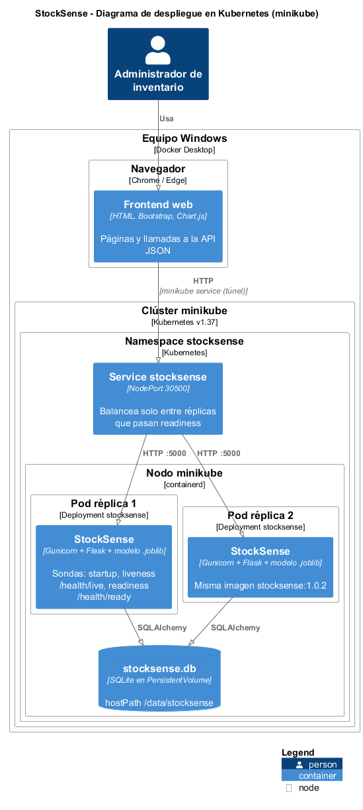

```
Navegador ──▶ minikube service (túnel) ──▶ Service "stocksense" (NodePort 30500)
                                               │ reparte el tráfico solo entre réplicas LISTAS
                              ┌────────────────┴────────────────┐
                        Pod réplica 1                       Pod réplica 2
                  initContainers: permisos + init-db   initContainers: permisos + init-db
                  Gunicorn + Flask + modelo .joblib    Gunicorn + Flask + modelo .joblib
                  sondas startup / liveness / readiness (las mismas)
                              └────────────────┬────────────────┘
                                 PersistentVolumeClaim "stocksense-data"
                                 PersistentVolume hostPath /data/stocksense (nodo minikube)
                                 └── stocksense.db (SQLite)
```

| Recurso (`k8s/`) | Para qué sirve |
|---|---|
| `namespace.yaml` | Aísla todos los recursos en el namespace `stocksense` |
| `pvc.yaml` | PersistentVolume + PersistentVolumeClaim: la base SQLite sobrevive aunque se eliminen todos los pods. El volumen está fijado al nodo `minikube` (`nodeAffinity`), por lo que las réplicas se programan allí y comparten el mismo archivo |
| `deployment.yaml` | 2 réplicas; *initContainers*; sondas; límites de CPU y memoria; `RollingUpdate` con `maxUnavailable: 0`; `preStop` |
| `service.yaml` | Dirección estable que balancea entre las réplicas listas |
| `pdb.yaml` | PodDisruptionBudget: en mantenimientos voluntarios siempre queda al menos 1 réplica |
| `kustomization.yaml` | Aplica todo con `kubectl apply -k k8s` |

**Imagen** (`Dockerfile`): `python:3.12.8-slim` + `requirements-docker.txt` (solo dependencias de ejecución) + código + **modelo ya entrenado**. El contenedor no incluye el notebook ni el dataset: **no puede entrenar**, solo cargar el `.joblib`. Corre con un usuario sin privilegios y Gunicorn como proceso principal (1 proceso, 4 hilos por réplica).

**Inicialización segura de datos:** el initContainer `init-db` ejecuta `flock /data/init.lock flask --app app init-db`. El candado `flock` impide que las dos réplicas carguen los datos iniciales al mismo tiempo. La primera los carga y la segunda detecta que ya existen. Verificado en los logs: *"Datos iniciales cargados"* en una réplica y *"La base de datos ya tenía datos; no se duplicaron"* en la otra.

### 12.2 Mecanismos de autorrecuperación

| Mecanismo | Configuración | Qué resuelve |
|---|---|---|
| **ReplicaSet** (Deployment con `replicas: 2`) | Si un pod desaparece, se crea otro | Pérdida de un pod |
| **restartPolicy: Always** | El kubelet reinicia el contenedor que termina | Caída del proceso |
| **livenessProbe** `GET /health/live` | cada 5 s; 3 fallas seguidas ⇒ reinicio | Aplicación colgada que no responde |
| **readinessProbe** `GET /health/ready` | cada 2 s; 1 falla ⇒ sale del Service | Réplica que no puede atender (BD o modelo no disponibles): deja de recibir tráfico sin reiniciarse |
| **startupProbe** | hasta 60 s para arrancar | Evita reinicios mientras se carga el modelo |
| **preStop** `sleep 5` | antes de apagar un pod | El Service deja de enviarle tráfico antes de que cierre |
| **RollingUpdate** `maxUnavailable: 0` | actualización gradual | Nuevas versiones sin interrumpir el servicio |
| **PersistentVolume** | `/data/stocksense` | Los datos no se pierden con los pods |

### 12.3 Simulación de fallas

Con `STOCKSENSE_ENABLE_CHAOS=true` (solo en el clúster; deshabilitado por defecto y en pruebas) existen dos endpoints para provocar **fallas reales**:

* `POST /health/chaos/crash`: envía `SIGTERM` al proceso principal (Gunicorn, PID 1). El contenedor termina y Kubernetes lo reinicia (`RESTARTS` +1).
* `POST /health/chaos/hang`: la réplica queda "colgada": `/health/live`, `/health/ready` y todas las páginas responden 503. Readiness la saca del balanceo en ~2 s y liveness la reinicia en ~15 s.

La tercera falla es externa: `kubectl delete pod` elimina un pod y el Deployment crea otro.

### 12.4 Resultados de las pruebas en el clúster (10-nov-2026)

Clúster: minikube v1.39.0, Kubernetes v1.37.0, Docker Desktop 29.7.2. Imagen `stocksense:1.0.1`. Durante la prueba, un pod cliente consultó `GET /predictions/api/model` a través del Service cada 0.25 s durante 110 s.

| Falla provocada | Reacción de Kubernetes | Peticiones fallidas del cliente |
|---|---|---|
| `kubectl delete pod` | Pod nuevo creado automáticamente | **0** |
| `POST /health/chaos/crash` | Contenedor reiniciado (`RESTARTS 1`) | 2 (≈ 0.5 s) |
| `POST /health/chaos/hang` | Evento *"Container stocksense failed liveness probe, will be restarted"*; contenedor reiniciado | 2 (≈ 0.5 s) |
| **Total** | | **427 correctas de 431 (99.1 %)** |

**Persistencia:** con todos los pods eliminados a la vez, la base conservó sus datos (7 192 ventas y 20 productos antes y después) y no se duplicaron. En ese caso extremo no queda ninguna réplica, así que hay unos 12 s sin servicio hasta que las nuevas están listas.

**Mejora aplicada tras la primera prueba:** en una primera versión (readiness cada 5 s × 2 fallas y sin `preStop`), el mismo experimento produjo unos 10 s de errores al colgarse una réplica y ~1 s al borrar un pod. Se ajustaron readiness (2 s × 1) y `preStop` (5 s) y se repitió la prueba con los resultados de la tabla. La evidencia está en [`docs/resultados_kubernetes.txt`](resultados_kubernetes.txt).

**Predicción en el clúster:** `POST /predictions/api/forecast` a través del Service devolvió un pronóstico calculado en vivo por el modelo cargado en la réplica.

### 12.5 Cómo ejecutarlo

Requiere Docker Desktop abierto, minikube y kubectl (ya instalados en el equipo del proyecto).

| Paso | Script (`k8s\`) | Comando equivalente |
|---|---|---|
| Desplegar | `desplegar.bat` | `docker build -t stocksense:1.0.2 .` · `minikube image load stocksense:1.0.2` · `kubectl apply -k k8s` |
| Abrir la app | `abrir_app.bat` | `minikube service stocksense -n stocksense` |
| Ver los pods en vivo | `ver_pods.bat` | `kubectl -n stocksense get pods -o wide -w` |
| Provocar fallas | `demo_fallas.bat` | menú con las 3 fallas y los eventos |
| Reiniciar los datos | `reiniciar_datos.bat` | `kubectl -n stocksense exec deploy/stocksense -- flask --app app init-db --reset` |
| Eliminar el despliegue | `eliminar.bat` | `kubectl delete -k k8s` |

En la barra lateral de la aplicación aparece **"Pod: …"**, el nombre de la réplica que atendió la página. Al recargar varias veces se ve cómo el Service reparte las visitas entre las dos réplicas.
